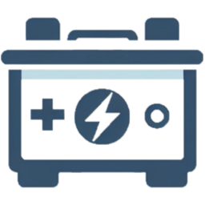

<p>
  ☕ <strong>Si cette intégration vous est utile, vous pouvez soutenir le projet :</strong>
</p>

<div style="white-space: nowrap; line-height: 0;">
  <a
    href="https://www.buymeacoffee.com/Marlboro62"
    target="_blank"
    rel="noopener noreferrer"
    style="display: inline-block; text-decoration: none; vertical-align: middle;"
  ></a>&nbsp;&nbsp;<a
    href="https://ko-fi.com/M4M2QL45X"
    target="_blank"
    rel="noopener noreferrer"
    style="display: inline-block; text-decoration: none; vertical-align: middle;"
  ></a>
</div>

# Battery Monitor BM6 pour Home Assistant


[](https://www.home-assistant.io/integrations/marketplace/)



Intégration personnalisée [Home Assistant](https://www.home-assistant.io) pour le moniteur de batterie Bluetooth **BM6**. Elle lit la tension, la température, le pourcentage et l'état de la batterie via un adaptateur Bluetooth ou un proxy ESPHome.

Ce dépôt est un fork de [Rafciq/BM6](https://github.com/Rafciq/BM6), sous licence MIT. Il a son propre domaine, `battery_monitor_bm6` : il peut donc être installé à côté de l'intégration d'origine (domaine `bm6`).

> ⚠️ Vous utilisez cette intégration à vos propres risques. L'auteur n'est pas responsable des dommages liés à son utilisation.

## Différences avec le projet d'origine

- **Choix du proxy Bluetooth** : un proxy précis peut être imposé pour chaque BM6. En mode « Automatique », tous les scanners sont essayés, du meilleur signal au moins bon.
- **Type de batterie EFB 12 V** (Enhanced Flooded Battery, batteries start & stop).
- **Plages FLA 12 V** revues, avec une détection de charge plus sensible.
- **Corrections** : l'état renvoyé par l'appareil n'était jamais reconnu (toujours « inconnu »), et le capteur d'état de l'appareil plantait sur un code inconnu.
- **Tension corrigée** (avec l'offset) utilisée dans l'historique et les statistiques.

## Prérequis

- Home Assistant **2026.10.0** ou plus récent
- Un adaptateur Bluetooth ou un proxy Bluetooth ESPHome à portée du BM6

## Installation

### Avec la Marketplace (Home Assistant 2026.11 et plus récent)

1. **Paramètres → Marketplace**, puis **Add from link** (en haut à droite).
2. Collez `https://github.com/Marlboro62/hass-bm6` et choisissez le type **Integration**.
3. Installez **Battery Monitor BM6**, puis redémarrez Home Assistant.

### Avec HACS (Home Assistant 2026.10)

1. Dans HACS, ouvrez le menu ⋮ en haut à droite, puis **Dépôts personnalisés**.
2. Ajoutez `https://github.com/Marlboro62/hass-bm6` avec le type **Intégration**.
3. Installez **Battery Monitor BM6**, puis redémarrez Home Assistant.

### Manuellement

Copiez le dossier `custom_components/battery_monitor_bm6` dans le dossier `custom_components` de votre configuration, puis redémarrez Home Assistant.

## Mise à jour depuis 2027.1.x ou depuis Rafciq/BM6

Depuis la version **2027.2.0**, le domaine de l'intégration est `battery_monitor_bm6` (auparavant `bm6`, comme l'intégration d'origine). Pour Home Assistant, c'est une nouvelle intégration : vos BM6 doivent être ajoutés de nouveau.

1. Faites une sauvegarde.
2. Supprimez vos BM6 dans l'ancienne intégration (**Paramètres → Appareils et services**).
3. Mettez à jour (ou installez) **Battery Monitor BM6**, puis redémarrez Home Assistant.
4. Ajoutez vos BM6 dans **Battery Monitor BM6** : ils sont aussi découverts automatiquement.
5. Les entités sont recréées : mettez à jour vos tableaux de bord et automatisations si leurs noms ont changé.

Si l'ancien dossier `custom_components/bm6` est resté, supprimez-le, sauf si vous utilisez aussi Rafciq/BM6.

> Les deux intégrations peuvent être installées côte à côte, mais ne configurez pas le même BM6 dans les deux à la fois : il n'accepte qu'une connexion Bluetooth à la fois.

## Configuration

**Paramètres → Appareils et services → Ajouter une intégration → Battery Monitor BM6.** Les BM6 à portée sont aussi découverts automatiquement.

Réglages disponibles :

- proxy Bluetooth (automatique ou imposé)
- algorithme de calcul : par l'appareil BM6, SoC/SoD ou CVR/DVR
- intervalle de mise à jour (10 s minimum, 120 s par défaut)
- corrections de tension et de température, unité de température
- tension (6 V ou 12 V) et type de batterie : FLA, AGM, GEL, EFB, NiCd, NiMH, Li-Ion, LiFePO4, LTO ou plages personnalisées

## Capteurs

| Capteur | Description |
|---|---|
| Tension | Tension mesurée, corrigée de l'offset |
| Température | Température mesurée, corrigée de l'offset |
| Pourcentage | Charge estimée selon l'algorithme choisi |
| État | `ok`, `low_voltage`, `under_voltage`, `discharging`, `idle`, `charging`, `over_voltage` |

Capteurs de diagnostic, désactivés par défaut : RSSI, pourcentage et état renvoyés par l'appareil, scanner Bluetooth utilisé, accélération et décélération rapides.

Des déclencheurs d'appareil sur les changements d'état sont disponibles dans les automatisations.

## Signaler un problème

Le support se fait uniquement via les [issues GitHub](https://github.com/Marlboro62/hass-bm6/issues). Joignez si possible le diagnostic de l'appareil et les journaux en mode debug :

```yaml
logger:
  logs:
    custom_components.battery_monitor_bm6: debug
```
